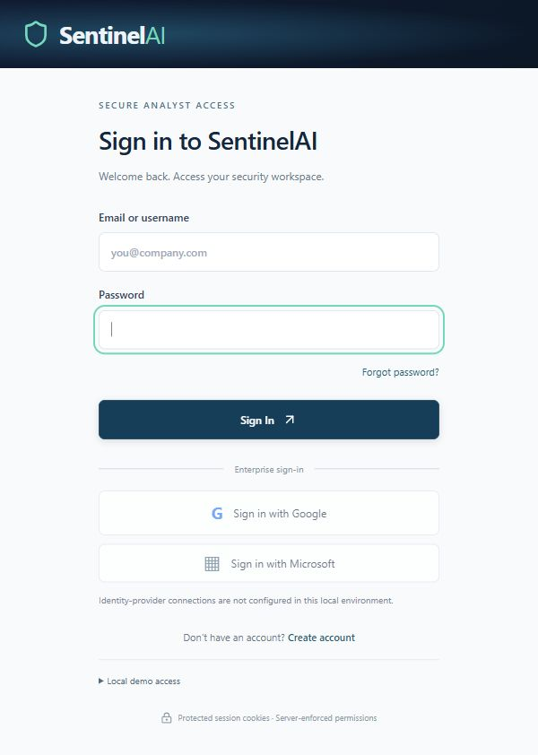

# SentinelAI

[](https://github.com/benree123/sentinelai/actions/workflows/ci.yml)

An evidence-first Security Operations and Incident Response portfolio application built with **React, TypeScript, FastAPI, SQLAlchemy and SQL**. SentinelAI turns fictional security events into explainable incidents and gives analysts a single workspace to investigate, document decisions and track resolution.

This is a local demonstration platform. It never scans external targets or executes containment commands. The release source is available on GitHub; this is not a hosted production deployment.

## Capabilities

**Implemented:** revocable sessions and four backend-enforced roles; live dashboard; validated event ingestion; eleven detection rules; optimistic incident updates; assignment and notes; audit trail; stored Markdown reports; analytics; source activity; session management; a paced Simulation Lab with fourteen fixed fictional scenarios.

**Optional / requires configuration:** local Ollama structured analysis, SMTP recovery/invitations and verified registration, PostgreSQL and HTTPS production settings. PostgreSQL tests and the Docker/PostgreSQL runtime have been verified in GitHub Actions; actual model inference and mail delivery remain unverified.

**Planned:** OAuth, MFA, reviewed database migrations, durable outbox/pub-sub, distributed rate limits, external threat intelligence, retention policies and cloud deployment. Redis and AWS are not connected.

## Architecture

```text
React / TypeScript → authenticated FastAPI → SQLAlchemy → SQLite or PostgreSQL
Simulation Lab → shared event transaction → deterministic detection → incidents/evidence/audit
WebSocket invalidations → authenticated refetch + periodic reconciliation
Incident evidence → deterministic briefing or optional local Ollama → human review
```

Ingestion holds a database write reservation/advisory lock so concurrent events cannot skip threshold evaluation. A filtered unique index prevents duplicate active correlations. Incident updates compare versions in SQL. WebSocket connections and rate limits are currently process-local; use one worker until shared coordination is implemented.

## Screenshots and demo



[Dashboard](docs/screenshots/overview.jpg) · [Investigation](docs/screenshots/investigation.jpg) · [Events](docs/screenshots/events.jpg)

Screenshots are illustrative captures of local fictional data and may precede small interface changes. [Watch/download the 90-second captioned walkthrough](docs/demo-preview.mp4). Briefing and copilot segments are explicitly labelled deterministic evidence assistance.

Run **Account takeover** as admin, manager or analyst. Eleven fictional events arrive over several seconds and produce a 95/100 critical incident plus a separate unknown-device signal. Inspect evidence and risk, prepare a labelled briefing, ask the copilot, then investigate/contain/resolve with a recorded reason. Containment is a workflow decision, not an external action.

## Free online demo deployment

See [Render + Neon setup](docs/FREE_DEPLOYMENT.md). The free-plan configuration is included in render.yaml. A live deployment has not yet been verified.

## Quick start

Prerequisites: Python 3.12 and Node 22.12+. From the repository root:

```powershell
python -m venv .venv
.venv/Scripts/Activate.ps1
npm run install:backend
npm run install:frontend
npm run build
npm run dev:backend
```

Open http://127.0.0.1:5090. First startup creates SQLite and generates a local password in `backend/data/local-credentials.txt`. Usernames: admin, manager, analyst, viewer. Generated credentials, signing keys, databases and sessions are excluded from source. Database/key storage resolves against the backend folder regardless of the launch directory.

For frontend hot reload, keep the backend running and use `npm run dev:frontend` in a second terminal. Vite proxies `/api` and WebSockets.

Local account registration works without SMTP and starts with **viewer** access. Email ownership is not checked in this mode; account activation is not proof of a verified address. Only administrators can grant analyst/manager roles. Configure `REQUIRE_EMAIL_VERIFICATION=true` for email verification. Recovery and teammate invitations still require SMTP.

## Developer commands

| Action | Root command |
|---|---|
| Backend dependencies | `npm run install:backend` |
| Frontend dependencies | `npm run install:frontend` |
| Backend development | `npm run dev:backend` |
| Frontend development | `npm run dev:frontend` |
| TypeScript | `npm run typecheck` |
| Production frontend build | `npm run build` |
| Frontend regression tests | `npm run test:frontend` |
| Backend suite | `npm run test:backend` |
| Complete test suite | `npm test` |
| Local PostgreSQL containers | `npm run docker:up` |

Root `pytest.ini` sets the backend import path. A fresh clone does not need generated local files. Activate the Python environment before npm commands that invoke Python.

## Configuration and containers

Copy `.env.example` to `.env` for **Compose** and replace the bootstrap/PostgreSQL placeholders with random values. Direct Python startup reads shell environment variables, not `.env` automatically. A bootstrap password override must have at least twelve characters. The local demo seeds four accounts sharing that password; replace demo account provisioning before deployment.

```powershell
docker compose up --build -d
```

Local Compose binds port 5090 to loopback and leaves PostgreSQL internal. Production uses an explicit override:

```powershell
docker compose -f compose.yaml -f compose.production.yaml up --build -d
```

Production startup requires Secure cookies, an HTTPS `SENTINEL_PUBLIC_URL` and an explicit random hexadecimal signing key of at least 32 bytes. Verification defaults to enabled. An HTTPS reverse proxy must preserve the external Host and forward protocol headers only from trusted proxies; configure Uvicorn's trusted proxy allowlist for that deployment. No TLS reverse proxy is bundled. Do not present the configuration as a verified production deployment.

Liveness: `/api/live-check`. Readiness/database query: `/api/health`. Authenticated dependency details: `/api/system/health`. Request logs include a generated correlation ID, route path, status and duration without request bodies/cookies/passwords. SMTP health reports configuration, not a verified successful delivery.

## Security design

- PBKDF2-SHA256, random salt, 600,000 iterations; bounded password input.
- Fifteen-minute HS256 JWT access cookies and seven-day absolute refresh sessions; transactional refresh rotation and server-side digests.
- HttpOnly/SameSite Strict cookies. Logout, password reset, suspension, role changes and owner revocation invalidate sessions.
- Same-origin custom headers plus exact Origin checks on writes; no cross-origin credential access. WebSockets validate sessions/origin and periodically revalidate.
- Five login attempts per IP/minute and canonical-account failure limits; mutation throttling. Limits are process-local and need a shared store for multiple workers.
- Backend RBAC for every sensitive operation; new registrants cannot select privileged roles.
- Fixed simulation enum and forbidden extra inputs: no arbitrary targets, commands, URLs or credentials.
- Deterministic risk weights are signals for investigation, not compromise probabilities.

Audit storage is application append-only, not cryptographically tamper-evident. SQL administrators can modify records. Schema `create_all` creates tables but is not a migration strategy.

## AI design

Detection and risk remain deterministic. The default **evidence briefing/assistant** is explicitly labelled and cites linked event IDs. The optional Ollama adapter uses a fixed loopback endpoint, bounded structured output and evidence-only instructions. Failures return the labelled deterministic fallback. Observations, hypotheses, recommended steps and limitations are separated. Model output never executes response actions.

No successful LLM inference is claimed in this environment. Prompt grounding does not guarantee factual correctness; analysts must verify statements against evidence.

## Validation and limitations

See [engineering report](docs/ENGINEERING_REPORT.md) for exact commands/results and [initial audit](docs/AUDIT.md) for findings. The standard `npm run build` passed on GitHub�s Linux runner and inside the Docker build. A restricted Windows host still reports `spawn EPERM`; the successful CI build confirms the standard command works without an alternate bundler.

The GitHub Actions definition checks SQLite/PostgreSQL, frontend tests/build, dependency advisories and Docker. The complete workflow passed in private pre-release verification: 67 tests on SQLite, 67 on PostgreSQL, three frontend tests, standard Vite build, dependency audits and Docker/PostgreSQL runtime smoke. The badge above shows the current public repository workflow. See [release verification](docs/RELEASE_VERIFICATION.md). Docker remains unavailable on the original Windows host. Tests use fictional disposable accounts and a dedicated `sentinel_test` database when `TEST_DATABASE_URL` is set; the PostgreSQL test schema is dropped between cases.

## Roadmap

Reviewed migrations and backup/restore drills; distributed event notifications and rate limits; real model evaluation; verified SMTP; OAuth/MFA; operational measurements; retention; incident pagination; TLS deployment and secret rotation. Complete and verify these before calling this application production-ready.
